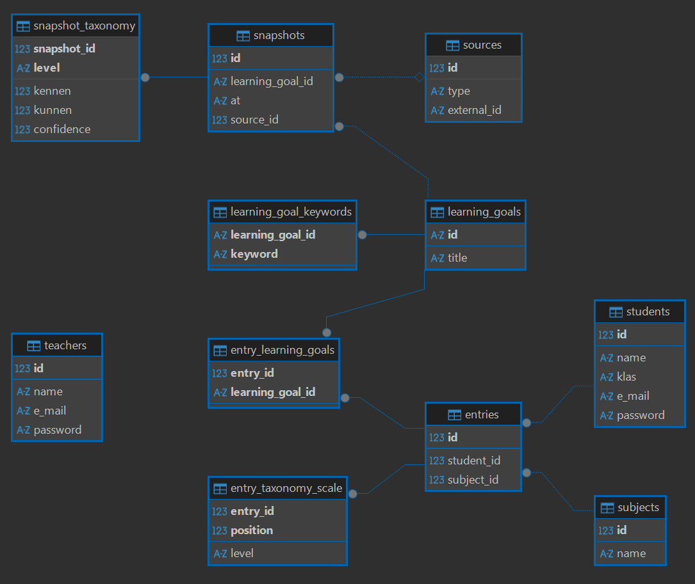

<!-- LTex: language=nl -->

# Werkplaats 3 (2026), Rest, 1C4, Lion

Gegevens:

- Team naam: 1C4 - Lion
- Teamleden:
  - Joris Oosterveld (1083819)
  - Maarten de Leeuw van Weenen (1044232)
  - Laurens Hill (1056274)
  - Aletta van der Star (1129629)
  - Shaemar Sardjo (1046782)

## Installatie

**Minimum python versie**: `python 3.13`

### Stap 1: Omgeving

Na het installeren van de python versie, maak, activeer, en installeer de benodigde modules voor de python omgeving met de volgende commando's in de terminal:

Maak de omgeving:

```shell
py -m venv .venv
```

Activeer de omgeving:

```shell
.venv.Scripts/activate
```

Installeer de modules:

```shell
pip install -r requirements.txt
```

### Stap 2: Maak de database



Na het opstarten van de omgeving, graag de database maken

<!-- How to login

first make sure you have the updated database.md. If this is not the case you will not be able to login. To get the latest database.db, run generate
database.py. If you already have a database.py, delete this first.
After doing that you can login with:
    the email of the user: This is the name of user + @gmail.com
    The password of the user: This is a random password each time you run generate_database.py
both can be found in the database.db

The email and password shown in the database are examples.
If the database ever contains real login data, those values should be used instead of the generated ones. -->