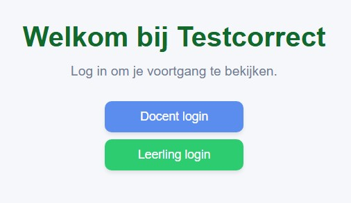

<!-- LTex: language=nl -->

# Werkplaats 3 (2026), Rest, 1C4 - Lion

Gegevens:

- Team naam: 1C4 - Lion
- Teamleden:
  - Joris Oosterveld (1083819)
  - Maarten de Leeuw van Weenen (1044232)
  - Laurens Hill (1056274)
  - Aletta van der Star (1129629)
  - Shaemar Sardjo (1046782)

## Requirements

Python (versie 3.13.0) https://www.python.org/downloads/ (Wanneer je python installeert, klik het hokje "Add python.exe to PATH" aan) </br>
Git (versie 2.44.0) https://git-scm.com/downloads

Volg deze handleiding om de repository van GitHub te klonen. (clone met de HTTPS key):
https://docs.github.com/en/repositories/creating-and-managing-repositories/cloning-a-repository 

## Installatie
### Stap 1: Virtual Environment (VENV)

Om de applicatie te kunnen starten moet er eerst een VENV worden aangemaakt.

Na het installeren van de python versie, maak, activeer, en installeer de benodigde modules voor de python omgeving met de volgende commando's in de terminal:

Navigeer naar de root van het project:

```shell
cd .\wp3-2026-rest-1c4-lion
```

Maak de omgeving:

```shell
python -m venv .venv
```

Activeer de omgeving:

```shell
.\.venv\Scripts\activate
```

Installeer de modules:

```shell
pip install -r requirements.txt
```


### Stap 2: Maak de database

Na het opstarten van de omgeving, graag de database maken met de volgende commando. Deze zal dus volgens het diagram hierboven gemaakt worden:

```shell
python .\generate_database.py
```

### Stap 3: Start de app

De app wordt opgestart met het volgende commando:

```shell
python .\app.py
```

Dit brengt je naar de landing page waar je kan inloggen als student of docent



Hiervoor dus de hebben we een aantal testusers (er staan meer gebruikers in de database):

| Type    | Email          | Password |
| ------- | -------------- | ---------|
| Docent  | john@gmail.com | John123  |
| Student | sam@gmail.com  | Sam123   |
| Student | alex@gmail.com | Alex123  |


## Cijfervalidatie

De app gebruikt cijfers van 1-10, waar 5.5 (of 55%) als **voldoende** wordt aangemerkt. De specifieke hoogte van dit getal is echter een _placeholder_ en kan natuurlijk veranderd worden als de opdrachtgever dat wil.
